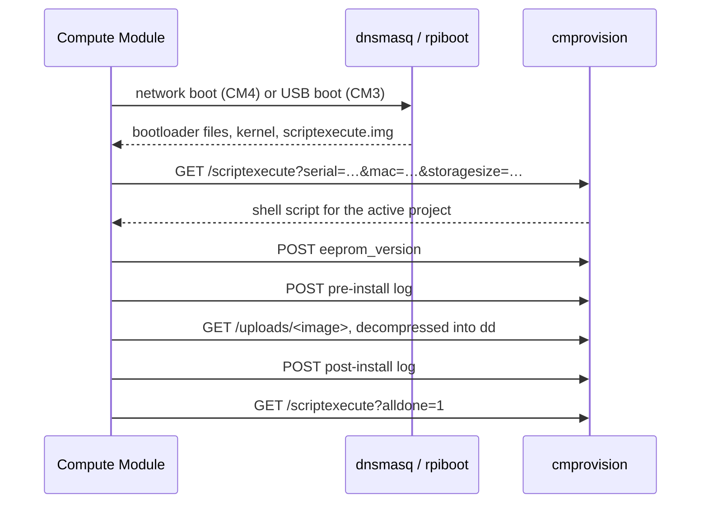

# How a Compute Module is flashed

Provisioning a module is a conversation between three parties:

- **The server**: the Raspberry Pi 4 running cmprovision, with eth0 on 172.20.0.1/16.
- **The boot services** it runs: dnsmasq for DHCP and TFTP, and rpiboot for booting over USB.
- **The module**, which boots a small Linux system called `scriptexecute`. That system asks the
  server for a shell script, runs it, and reports back.

Nothing is installed on the module beforehand. Everything it runs comes from the server, and
the server decides what to do from the *active project*.

## 0. Before any module is connected

These steps happen in the web interface:

1. **An image is uploaded** on the Images page. It's stored under a random name in
   `/var/lib/cmprovision/public/uploads/`. A background job then computes the SHA256 of the
   compressed file, and the SHA256 and size of the decompressed disk image
   (`src/images.rs`).
2. **A project is created and made active** (`src/pages/projects.rs`). The project chooses:
   - the image to write and the destination device, normally `/dev/mmcblk0` for the eMMC;
   - whether to verify the image after writing;
   - optionally an EEPROM firmware image and its `bootconf.txt` settings;
   - the pre-install and post-install scripts;
   - whether, and when, to print a label.
3. **Activating a project with EEPROM firmware prepares the firmware.** The selected
   `pieeprom-*.bin` is copied with the project's settings written into its embedded
   `bootconf.txt` (`src/eeprom.rs`). The result is written to `public/uploads/pieeprom.bin`,
   and its SHA256 is stored as the `active_eeprom_sha256` setting.

Only one project is active at a time. Every module that boots is provisioned with it.

## 1. The module boots `scriptexecute`

The boot files are in `/var/lib/cmprovision/scriptexecute/`.

**CM4 and Pi 4, over Ethernet:**

1. The module's bootloader starts a network boot. Its DHCP request carries Raspberry Pi's
   client identifier (option 97).
2. dnsmasq (`etc/dnsmasq.conf`) recognises that identifier. It hands out an address in
   172.20.0.0/16 and offers "Raspberry Pi Boot".
3. The bootloader fetches `start4.elf`, `fixup4.dat`, `config.txt`, the device tree, the kernel
   and `scriptexecute.img` over TFTP.

dnsmasq only answers devices that send Raspberry Pi's identifier. eth0 must still be on a
switch with only the modules to provision, because any Raspberry Pi set to network boot would
be provisioned too.

**CM3 and CM3+, over USB:**

1. `cmprovision-rpiboot` runs `rpiboot -l -d /var/lib/cmprovision/scriptexecute`. It serves
   `bootcode.bin`, `start.elf` and the rest to every module that appears in USB boot mode.
2. `config.txt` gives these modules the `dwc2` overlay in peripheral mode and
   `cmdline.txt.ipv6ll`, which adds `usbipv6ll` to the kernel command line. The module becomes
   a USB network adapter and reaches the server at an IPv6 link-local address.

**What `scriptexecute` does on the module.** Its source is in the separate
`raspberrypi/scriptexecute` project, not in this repository; the following comes from the boot
files here.

1. **Kernel options.** `config.txt` loads the `scriptexecute.img` initramfs. It enables pull-ups
   on GPIO 5, 13 and 21 so the jumpers on the IO board can be read. On a CM4 it enables SPI
   access to the EEPROM on GPIO 40–45 for `flashrom`.
2. **Script URL.** The kernel command line carries
   `script=http://…/scriptexecute?serial={serial}&model={model}&storagesize={storagesize}&mac={mac}&inversejumper={jumper}&memorysize={memorysize}&temp={temp}&cid={cid}&csd={csd}&bootmode={bootmode}`.
3. **Placeholders.** `scriptexecute` fills these in with the module's serial number, model,
   eMMC size in 512-byte sectors, MAC address, the inverted jumper reading, memory, SoC
   temperature, the eMMC's CID and CSD registers, and the boot mode.
4. **Running the script.** It downloads the URL and runs the shell script it gets back.

## 2. The server answers with a script

`GET /scriptexecute` without `alldone` or an uploaded file starts provisioning
(`start_provisioning` in `src/provision.rs`):

1. **Validate the request.** The serial must be alphanumeric (otherwise 401). The `Host` header
   must be a plain host name or IP address (otherwise 400), because it ends up in the script.
2. **Record the module.** A `cms` row for the serial is created or reset:
   - MAC address, model, memory, storage size, CID/CSD and starting temperature;
   - the project, image file name and image SHA256;
   - `provisioning_started_at`.

   Without a MAC address it derives `b8:27:eb:…` from the serial.
3. **Identify the board** the module sits in, shown in the log and on labels:
   - With a managed switch configured (`cmprovision ethernetswitch-configure`), the switch's
     MAC table is queried over SNMP, and the port name or alias becomes the board
     (`src/switch.rs`).
   - Otherwise the jumper bits are inverted and shown as bits plus decimal value, for
     example `0010 (2)`.
4. **Refuse what cannot work.** Each case is logged and answered with an `echo` of the reason:
   - there is no active project;
   - verification is enabled but the uncompressed hash isn't computed yet;
   - the image isn't a whole number of 512-byte sectors;
   - the target is the eMMC but the module reports none;
   - the image is larger than the eMMC;
   - the project flashes EEPROM firmware that isn't prepared.
5. **Assemble the steps:**
   - the project's pre-install and post-install scripts, ordered by priority, then id;
   - **"Flash EEPROM firmware"** in front of the pre-install scripts when the project has
     EEPROM firmware;
   - **"Verifying written image"** in front of the post-install scripts when verification is
     enabled.
6. **Log and print.** It logs "Provisioning started." and, when the project prints labels
   before provisioning, prints one now (`src/label.rs`).
7. **Render the script** (`src/script.rs`). For a USB-connected CM3 the `Host` is an IPv6
   address; `%usb0` is added so the module reaches the server through its USB interface.

## 3. The module runs the script

The script runs on the module with `set -o pipefail`. Each step below matches a block in
`src/script.rs`.

1. **Environment.** It exports `SERIAL`, `SERVER`, `STORAGE`, `PART1` and `PART2` for user
   scripts. `PART1`/`PART2` are `/dev/mmcblk0p1`/`p2` for devices ending in a digit, else
   `/dev/sda1`/`2`. It also feeds 64 random characters to `/dev/urandom`, because a freshly
   booted module has little entropy.
2. **Writes every step to `/tmp`**, as `/tmp/pre-<id>.sh` and `/tmp/post-<id>.sh`, using a
   quoted heredoc so nothing in them is expanded.
3. **Reports the current EEPROM version.** This is skipped when the project flashes firmware
   anyway. It runs `vcgencmd bootloader_version`. In boot mode 3 (USB boot) it instead reads
   the EEPROM over SPI with `flashrom` and extracts `VERSION:` and `BUILD_TIMESTAMP=`. The
   result is posted back as the `eeprom_version` file.
4. **Runs the pre-install steps,** appending their output to `/tmp/pre.log`. Steps marked
   *background* are started and not waited for. On failure it posts the log with the exit
   code and `phase=preinstall`, then stops. After all of them it posts the log with
   `retcode=0`.
   - **Flash EEPROM firmware** downloads `/uploads/pieeprom.bin` and checks it against the
     prepared SHA256 with `sha256sum -c`, then writes it with
     `flashrom -p linux_spi:dev=/dev/spidev0.0 -w`. A failed checksum aborts before anything
     is written.
5. **Writes the image:**
   - `blkdiscard` on the target device first;
   - then `curl` of `/uploads/<image>`, decompressed by `gzip`, `xz` or `bunzip2`, piped into
     `dd of=$STORAGE conv=fsync obs=1M`. The image streams straight from the server to the
     eMMC; it's never stored on the module.

   On failure it posts `/tmp/dd.log` with `phase=dd` and stops. Afterwards `partprobe` re-reads
   the partition table, so post-install scripts can mount `$PART1` and `$PART2`.
6. **Runs the post-install steps,** the same way into `/tmp/post.log`, posting it with
   `phase=postinstall`.
   - **Verifying written image** drops the page cache and reads back exactly the image's size
     from the device with `dd`, then compares the SHA256 with the uncompressed hash computed
     at upload. A mismatch exits with code 2, so the failure is reported.
   - The seeded scripts, for example, grow the root partition to fill the eMMC.
7. **Reports completion** with `alldone=1`, the end temperature, and `verify=1` when
   verification ran.
8. **Signals the operator.** It disconnects the USB gadget, so a CM3 drops off the bus. On
   boards with two LEDs it blinks them alternately and indefinitely as the "done" sign.

## 4. The server records the outcome

The same endpoint handles the reports, picked by what the request carries:

| Request | What the server does |
|---|---|
| `eeprom_version` file | Stores it in `cms.firmware`, adding a readable date when it contains `BUILD_TIMESTAMP=`. |
| `log` file with `phase` and `retcode` | Stores pre-/post-install output, truncated at 1 MiB, and the return code. A non-zero code logs an error with the output. A failure during `preinstall` or `dd` also clears the image fields, because no image was written. |
| `alldone=1` | Sets `provisioning_complete_at` and the end temperature. Logs "Provisioning completed.", adding "Verification successful." when `verify=1`. Prints the label if the project prints after provisioning. |

The dashboard shows the resulting log. The CMs page lists every module with its details, script
output and duration, and can export all of them as CSV.

## Where things go wrong, and what you see

| Symptom | Likely cause |
|---|---|
| Module never appears in the log | No DHCP/TFTP answer: check `cmprovision-dnsmasq` on the Settings page. For CM3, check `cmprovision-rpiboot` and the USB boot jumper. |
| "No active project set" | Make a project active. |
| "Verification enabled, but uncompressed SHA256 not computed yet" | The image is still being hashed after upload; wait and power-cycle the module. |
| "Image does not fit in storage" / "Missing eMMC/SD card." | Wrong image for this module, or a Lite module without eMMC with `/dev/mmcblk0` as target. |
| "EEPROM firmware of the active project is not prepared" | Make the project active again, so `pieeprom.bin` is staged. |
| Error during `dd` | Download or decompression failed, or the eMMC is faulty; the log shows dd's output. |
| Error during post-install with return code 2 | Verification read back different data than was written. |
